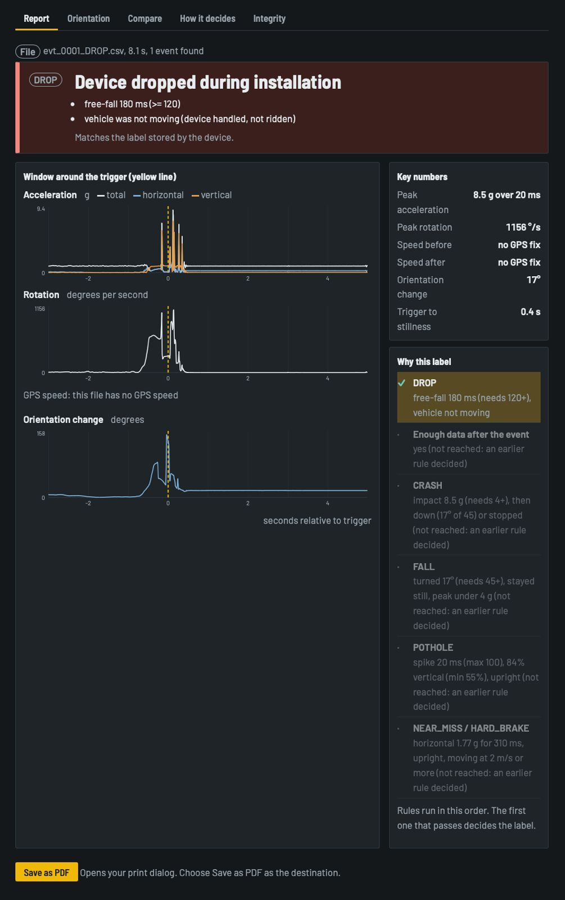
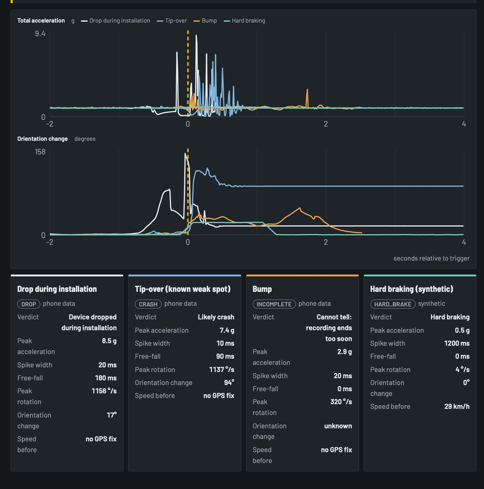

# RoadRec

A low-cost crash and near-miss event recorder for two-wheelers and small commercial vehicles, built on a
Seeed XIAO ESP32-S3 (Sense), an MPU6050 IMU and a GPS module. It keeps a rolling buffer of motion data,
and when something happens it saves the 10 s before and 6 s after, labels it with **explainable physics rules**
(no black-box model), and writes it to an SD card. A browser-based reader turns the file into a readable
report with the evidence behind each verdict.

Built for the hackathon problem *"What actually happened on that road?"*

> **Status: prototype.** The detection logic is tested on a laptop against phone recordings. The firmware
> has **not yet run on real hardware**. See [What is and isn't verified](#what-is-and-isnt-verified).

## Screenshots

| Report for a dropped device | Four events on one time scale |
|---|---|
|  |  |

## What it does

| Event | Rule (simplified) |
|---|---|
| `DROP` | Free-fall of 120 ms or more while the vehicle was not moving |
| `CRASH` | Impact of 4 g or more while moving, then lying down or stopped |
| `FALL` | Orientation changed 45° or more and stays there, peak under 4 g |
| `NEAR_MISS` | Hard deceleration with a swerve or 0.7 g or more, upright, ride continues |
| `HARD_BRAKE` | Sustained horizontal deceleration of 0.35 g for 400 ms, no swerve |
| `POTHOLE` | Spike of 100 ms or less, mostly along gravity, upright, ride continues |
| `HANDLING` / `MINOR_IMPACT` / `BUMP` | Carried or low-energy events, no alert |
| `INCOMPLETE` | Not enough data after the event to judge, reported as "cannot tell" |

The classifier measures gravity itself and uses only angles and magnitudes, so the board can be mounted in any fixed orientation.
Full thresholds and the evidence shown per verdict are on the reader's "How it works" tab.

## Repository layout

```
web/index.html     Browser reader: load an event CSV or read it over USB, see the report, verify its SHA-256
firmware/          PlatformIO project for the XIAO ESP32-S3
  src/             Sampling, IMU/GPS drivers, SD storage, serial export, bench-test modes
  lib/roadcore/    Detector + classifier in portable C++ (no Arduino dependency)
  host/replay.cpp  Runs roadcore on a laptop for testing
  tools/           Compare firmware logic against the Python reference
python/             Reference classifier, Sensor Logger converter, evaluation scripts
samples/            Example event CSVs (see samples/README.md)
docs/BENCH_TESTS.md  Tests you can run with just the board and an SD card (no IMU/GPS)
```

## The web reader

**Live version: https://pratyushzzz.github.io/roadrec/**

Or open `web/index.html` locally in Chrome or Edge. The live page is published from `web/` by a GitHub Actions workflow. Web Serial (USB connect) needs HTTPS or a local file, and Pages provides HTTPS.

- Loads an event CSV (`t, ax, ay, az, gx, gy, gz`, optional `speed`) entirely in the browser; nothing is uploaded.
- "Connect recorder" reads saved events straight from the board over USB (Web Serial, needs Chrome/Edge on a computer).
- "Has this file been changed?" computes the file's SHA-256 and compares it with the `.sha256` file the device writes next to each event.
- The sign-in screen is a **local demo only**: accounts live in the browser's `localStorage`, with no server and no real security. Use "Continue as guest".

## Firmware quick start

1. Install VS Code + the PlatformIO extension, open `firmware/`.
2. Wire the board (3.3 V logic):

   | Part | Pin | XIAO pin |
   |---|---|---|
   | MPU6050 | SDA / SCL | D4 (GPIO5) / D5 (GPIO6) |
   | GPS | TX / RX | D7 (GPIO44) / D6 (GPIO43) |
   | SD card | on the Sense expansion board | GPIO21 (CS), 7, 8, 9 |

3. Build and upload, then open the serial monitor at 115200.

More detail, expected serial output and first-power-up checks are in [`firmware/README.md`](firmware/README.md).

## What is and isn't verified

| Part | Status |
|---|---|
| `roadcore` classifier (C++) | Gives the same labels as the Python reference on 70/70 synthetic and 30/30 real phone recordings |
| Accuracy on the frozen test set | **12/20 (60%)**: drops 7/7, no-alert 5/5, **tip-overs 0/8** (7 labelled CRASH, 1 DROP). Rules were frozen on 4 Oct 2026 before this set was recorded |
| Hard brake, near miss, pothole, real crash | Rules written, **no recordings yet** |
| Speed-based rules and false-alert rate while riding | Never run on real GPS data; not measured |
| `imu.h`, `gps.h`, `storage.h`, `main.cpp` | Syntax-checked only, never run on a board |
| Power-loss survival, vehicle power, enclosure | Not built |

The MPU6050 clips at 16 g, so crash peaks it records are lower bounds. See "Next steps" in the firmware README.

## Limitations

This produces *a reading for investigation, not a legal finding about fault*. It does not estimate position, since distances from integrating acceleration drift quickly.

## License

[MIT](LICENSE). Copyright (c) 2026 Pratyushzzz.

RoadRec is a prototype and is not a certified safety device. Do not rely on it to detect or report real crashes.
